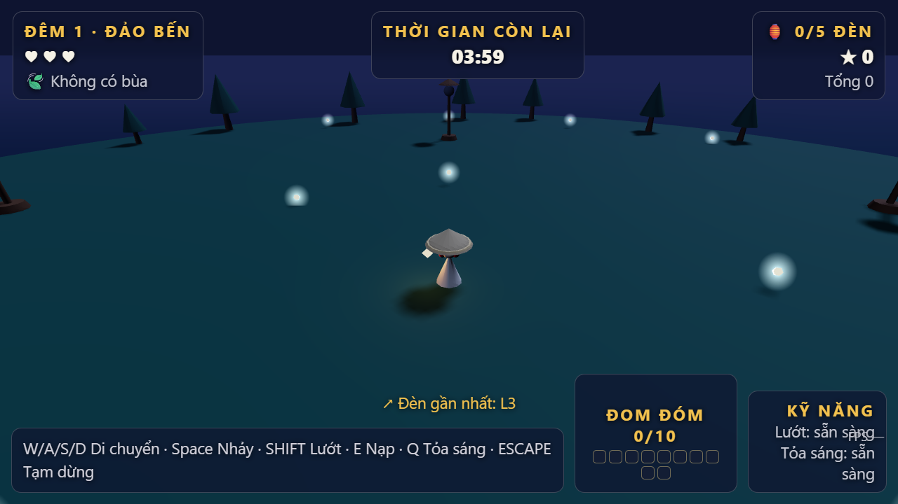
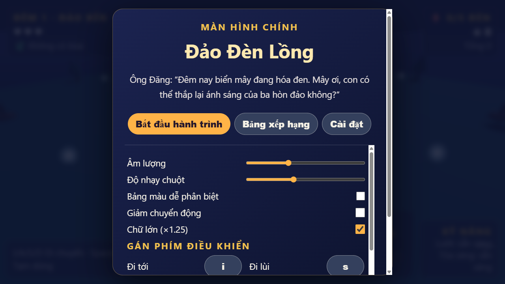

# Đảo Đèn Lồng — Bình minh v1.0.0

**Day 12 · AI SDLC · Phase 4 · Test Contract v1.3**

Game 3D cổ tích viết bằng **Three.js + TypeScript + Vite**: Mây đi qua ba hòn đảo, thu đom đóm và giữ đủ đèn lồng sáng đến bình minh. Đèn hao dầu, Bóng Mực đuổi theo và có thể hút dầu của đèn yếu. Đội nón lá, mang đèn nhỏ, Mây có thể chạy, nhảy, lướt, tỏa sáng, châm dầu và thắp lại đèn.



**Bản phát hành:** [GitHub Releases](https://github.com/killy-mv/K5-L3A-Day12-NguyenVanMinh-2A202603551-AI-SDLC/releases/tag/v1.0.0) · [Video demo MP4](docs/demo/demo.mp4) · [CHANGELOG.md](CHANGELOG.md).

## Yêu cầu hệ thống

- Windows 10/11, macOS hoặc Linux; Node.js **24+**; npm.
- Chrome hoặc Edge hiện đại hỗ trợ **WebGL 2**. Card đồ họa rời không bắt buộc để chơi, nhưng FPS phụ thuộc GPU/driver.
- Không cần database, Docker hoặc cài đặt engine. Headless và soak test không yêu cầu GPU.
- Benchmark cần Chrome hoặc Chromium và máy có khả năng mở trình duyệt 1280×720. Có thể đặt đường dẫn bằng `CHROME_PATH`.

## Cài và chơi từ clone sạch — tối đa 3 lệnh

Sau khi clone repo và `cd` vào thư mục gốc:

```bash
npm --prefix web ci
npm --prefix web run build
node scripts/run.mjs
```

Mở **http://127.0.0.1:4173/** trong Chrome/Edge. Server tích hợp cung cấp cả web tĩnh và **bảng xếp hạng lưu trên đĩa** trong `data/leaderboard.json`.

**Dùng file Release:** tải `dao-den-long-v1.0.0-web.zip`, giải nén, chạy `node scripts/run.mjs` ở thư mục giải nén và mở địa chỉ trên. Không cần npm vì bản build đã có sẵn. Nếu chỉ đưa `web/dist` lên hosting tĩnh, leaderboard fallback sang localStorage; để xuất ra file JSON phải dùng server Node đóng gói.

## Ba đêm và luật chơi

| Đêm | Tên | Thời lượng | Đèn lớn | Tối thiểu sáng lúc bình minh |
|---|---|---:|---:|---:|
| 1 | Đảo Bến | 240 s | 5 | 3 |
| 2 | Đảo Cau (hai bờ và cầu tre) | 270 s | 6 | 4 |
| 3 | Đảo Chuông (ba tầng, gió mạnh) | 300 s | 7 | 5 |

**Thắng:** còn Ngọn Lửa tại tick bình minh, và ít nhất 60% đèn còn sáng. **Thua:** hết máu bất kỳ lúc nào, hoặc chưa đủ đèn sáng khi hết thời gian. Thắp đủ tất cả đèn trước thời hạn không làm kết thúc Đêm.

- Đèn sáng tiêu hao 1 dầu/giây; khi Bóng Mực ở trạng thái `drain`, mỗi con hút thêm 5 dầu/giây.
- Đèn sáng có thể châm dầu bằng đom đóm (+10 dầu/đom đóm, tối đa 100). Đèn chưa từng sáng cần 10 đom đóm để thắp; đèn tắt đã từng sáng chỉ cần 5 để thắp lại.
- Đèn dưới 30 dầu mất vùng an toàn, nhấp nháy cảnh báo. Đèn tắt bị xẹp và có vết rách để nhận biết mà không cần phân biệt màu.
- Sức chứa = `min(20, 10 + 2 × số lần thắp thành công)`, gồm thắp lại. Tỏa Sáng tốn 3 đom đóm, làm Bóng Mực choáng. Bùa Gió cho tăng tốc và lướt nhanh.
- Điểm: +5/đom đóm nạp, +100 thắp lần đầu, +40 thắp lại, +5 mỗi Bóng Mực trúng Tỏa Sáng (+15 nếu đang hút dầu). Thưởng thắng: `50 + floor(fuel)`/đèn còn sáng và +50/Ngọn Lửa còn lại. Không thưởng thời gian.

## Điều khiển và accessibility

| Mặc định | Hành động |
|---|---|
| W / S / A / D | Tới / lùi / trái / phải |
| Di chuột (không phải giữ click) | Xoay camera |
| Cuộn chuột | Thu/phóng |
| Space | Nhảy |
| Shift | Lướt |
| E | Tương tác / nạp / châm dầu |
| Q | Tỏa Sáng |
| Esc | Tạm dừng / tiếp tục |

Vào **Cài đặt** để gán lại cả 9 hành động, nhận cảnh báo khi trùng phím và dùng **Khôi phục phím mặc định**. Cài đặt được lưu sau khi tải lại trang. Các tuỳ chọn khác: âm lượng, độ nhạy chuột, bảng màu dễ phân biệt, giảm chuyển động và chữ lớn (×1.25). Ở 1280×720, văn bản giao diện tối thiểu 18 px; có cảnh báo chữ/hướng cho Bóng Mực xuất hiện, đèn ít dầu, gió sắp tới và 10 giây cuối.



## Bảng xếp hạng cục bộ

Sau khi thua hoặc thắng Đêm 3, nhập tên gồm **3–12 ký tự `[A-Za-z0-9_]`** rồi lưu. Top 10 sắp giảm theo điểm; bằng điểm thì thời điểm đạt trước xếp trên. Mỗi mục chứa `name`, `score`, `nights_won`, `achieved_at` (ISO 8601 có múi giờ), `seed`. Bảng vẫn còn sau khi thoát chương trình.

Xem bảng qua **Bảng xếp hạng** ở menu chính. Xuất bằng lệnh tương thích `run_cmd` (không cần khởi động server):

```bash
node scripts/run.mjs --export-leaderboard out.json
```

Kết quả: `{"entries":[...]}` theo đúng thứ tự. Các file cá nhân trong `data/` không được commit vào Git.

## Headless 60 Hz và Test Contract v1.3

Root `game.contract.json` định nghĩa `build_cmd`, `run_cmd`, `headless_cmd`, `bench_cmd`, `soak_cmd` và tuning. Mọi luật headless v1.0–v1.2 còn hiệu lực được giữ lại.

```bash
node web/src/headless.mjs --seed 42 --night 1 --ticks 600 --out night1.jsonl --snapshot-every 10
node web/src/headless.mjs --seed 42 --night 2 --scenario web/tests/scenarios/phase-3/drain.json --ticks 60 --out drain.jsonl
```

Mỗi tick gameplay = 1/60 giây; khi tạm dừng, `tick` tăng nhưng `sim_tick`, dầu và đồng hồ đứng yên. Đầu ra JSONL gồm snapshot/event/end, luôn tất định cùng seed/scenario/inputs. Headless không mở cửa sổ hoặc cần GPU.

## Benchmark FPS (đúng cảnh chuẩn)

```bash
node scripts/bench.mjs --seed 42 --duration 30 --out bench.json
```

Lệnh chạy Chrome cửa sổ 1280×720, cảnh **Đêm 1** có đúng 200 Bóng Mực `wander`, 100 đom đóm và 3 đèn L1–L3 đang sáng. Không spawn, nhặt, đánh, tiêu hao dầu hoặc kết thúc Đêm; Mây đứng (0,0,0). Camera bay ngược kim đồng hồ ở bán kính 30m, Y=15, 15 giây/vòng. Khởi động 3 giây, đo thực tế 30 giây bằng `requestAnimationFrame` rồi thoát.

`bench.json` xuất `avg_fps`, `p1_low_fps`, `frame_ms_p95`, `frames`, `load_ms`, `peak_mem_mb`, `vsync_off`, `renderer`, `os`. FPS là frame time của Chrome thực tế, không phải FPS giả lập. **`peak_mem_mb: null`** vì bản web không có API bảo đảm đo RSS cả Chrome/GPU; `vsync_off:false` là giá trị thận trọng dù Chrome được cấp cờ xin tắt vsync, do trình duyệt không xác nhận tắt được. Các con số máy cá nhân chỉ để tham khảo; giảng viên đo lại trên cấu hình chung.

Kết quả commit: [docs/proof/phase-4/bench.json](docs/proof/phase-4/bench.json). Ngưỡng: trung bình ≥60 FPS, 1% low ≥30 FPS, tải ≤10.000 ms.

## Soak test 10 đêm (cùng một tiến trình)

```bash
node --expose-gc scripts/soak.mjs --seed 7 --nights 10 --out soak.json
```

Đêm i dùng seed `7+i`; xoay Đêm 1→2→3; mỗi 30 tick chọn hướng mới, các nút jump/dash/pulse/interact theo xác suất từng tick 5%/3%/2%/10%. Kết quả là 10 trạng thái thắng/thua, số crash, RSS sau tải Đêm đầu và sau reset Đêm cuối, thời lượng thực. Ngưỡng: không crash và RSS cuối ≤120% RSS đầu. Dùng core headless, không GPU. Kết quả: [docs/proof/phase-4/soak.json](docs/proof/phase-4/soak.json).

## Test và bằng chứng

```bash
npm --prefix web test
npm --prefix web run build
node scripts/verify.mjs
node scripts/browser-smoke.mjs
```

Bộ test gồm regression Phase 1–3, Contract v1.3, leaderboard persist/export, soak; Chrome smoke kiểm tra accessibility và leaderboard. Mô tả DoD, log thật, benchmark và soak: [docs/proof/phase-4/README.md](docs/proof/phase-4/README.md).

## Tài liệu bàn giao

- [CHANGELOG.md](CHANGELOG.md) — cả 4 phase; [CREDITS.md](CREDITS.md) — nguồn asset/AI; [LICENSE](LICENSE).
- [Retro 4 phase](docs/retro-phase-4.md) — bài học, lỗi AI, công sức và token/chi phí ước tính.
- [ADR-0003](docs/adr/0003-lantern-fuel-and-dawn.md) — mô hình đèn; [AGENTS.md](AGENTS.md) — harness phát triển.
- [MP4 demo dưới 5 phút](docs/demo/demo.mp4), [các bằng chứng Phase 4](docs/proof/phase-4/README.md).
- Git history/tag `phase-1`, `phase-2`, `phase-3`, `phase-4`; Release `v1.0.0`.

**Sáng tạo của tôi:** mô hình low-poly nón lá của Mây với đèn treo nhỏ; rừng cây, biển mây, ánh sáng vàng ấm/tím đen, Bùa Gió/Gió Lạc, thanh nhiên liệu nổi, gợi ý HUD, âm thanh tổng hợp Web Audio. Benchmark tắt các thực thể sáng tạo không thuộc cảnh chuẩn; không thay đổi đầu ra headless.
